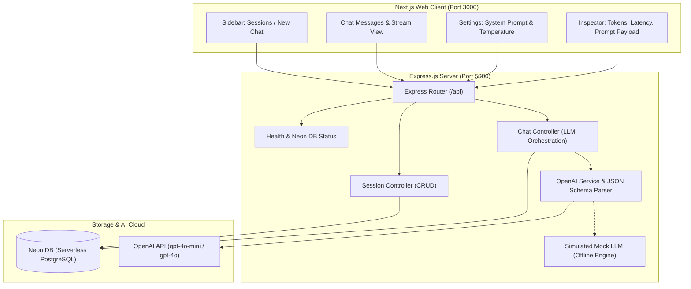

# Technical Implementation Plan: AI Text Assistant

**Project Name:** PromptCraft Studio (PromptCraft-Studio)  
**Database:** Neon DB (Serverless PostgreSQL)  
**Backend:** Express.js (Node.js, TypeScript, Prisma ORM, OpenAI SDK)  
**Frontend:** Next.js (App Router, TypeScript, Tailwind CSS, Lucide Icons)  
**Goal:** Build a production-grade AI Text Assistant while mastering LLM Fundamentals, LLM Behavior, and Prompt Engineering.

---

## 1. System Architecture



---

## 2. Technology Stack & Key Decisions

| Component | Technology | Rationale |
| :--- | :--- | :--- |
| **Frontend** | Next.js 15 (App Router), Tailwind CSS, Lucide React | Modern, reactive UI with instant updates, markdown styling, and modular components |
| **Backend** | Express.js, TypeScript, `tsx` | Lightweight, robust REST API server handling request validation and streaming |
| **Database** | Neon DB (Serverless PostgreSQL) | Serverless Postgres with automatic SSL, branching capabilities, and high performance |
| **ORM** | Prisma ORM | Type-safe database queries, automated migrations, and seamless Neon connection pooling |
| **AI Client** | OpenAI Official Node SDK (`openai`) | Native support for Chat Completions, structured JSON outputs, and token usage reporting |
| **Schema Validation**| Zod | Strict runtime schema parsing for structured JSON outputs |

---

## 3. Database Schema (Neon DB)

The database schema is defined in Prisma (`prisma/schema.prisma`):

```prisma
datasource db {
  provider = "postgresql"
  url      = env("DATABASE_URL")
}

generator client {
  provider = "prisma-client-js"
}

model Session {
  id             String    @id @default(uuid())
  title          String    @default("New Conversation")
  systemPrompt   String    @default("You are a helpful and knowledgeable AI assistant.")
  model          String    @default("gpt-4o-mini")
  temperature    Float     @default(0.7)
  maxTokens      Int       @default(1500)
  responseFormat String    @default("text") // "text" | "json_object"
  createdAt      DateTime  @default(now())
  updatedAt      DateTime  @updatedAt
  messages       Message[]

  @@map("sessions")
}

model Message {
  id               String   @id @default(uuid())
  sessionId        String
  session          Session  @relation(fields: [sessionId], references: [id], onDelete: Cascade)
  role             String   // "system" | "user" | "assistant"
  content          String   @db.Text
  structuredData   Json?    // Optional structured JSON response
  promptTokens     Int      @default(0)
  completionTokens Int      @default(0)
  totalTokens      Int      @default(0)
  latencyMs        Int      @default(0)
  createdAt        DateTime @default(now())

  @@index([sessionId])
  @@map("messages")
}
```

---

## 4. API Endpoints Specification

### 4.1 System & Health
- `GET /api/health`
  - Verifies Neon DB connectivity (`prisma.$queryRaw\`SELECT 1\``)
  - Reports AI provider configuration status (`live` or `mock`)

### 4.2 Session Management
- `GET /api/sessions`
  - Returns list of conversations ordered by `updatedAt DESC`
- `POST /api/sessions`
  - Body: `{ title?, systemPrompt?, temperature?, maxTokens?, responseFormat? }`
  - Creates a new session in Neon DB
- `GET /api/sessions/:id`
  - Returns session details and full chronologically ordered message history
- `PATCH /api/sessions/:id/config`
  - Updates `systemPrompt`, `temperature`, `maxTokens`, or `responseFormat`
- `DELETE /api/sessions/:id`
  - Deletes conversation and all linked messages

### 4.3 Chat & LLM Execution
- `POST /api/sessions/:id/messages`
  - Body: `{ content: string }`
  - Steps:
    1. Persist user message to Neon DB.
    2. Assemble context window: Fetch active session settings and past messages.
    3. Measure start timestamp.
    4. Call OpenAI API (or Mock Engine) with payload:
       - `model`, `messages: [{ role: 'system', content: systemPrompt }, ...history, { role: 'user', content }]`
       - `temperature`, `max_tokens`
       - `response_format: { type: "json_object" }` if structured mode is active.
    5. Calculate `latencyMs = Date.now() - startTime`.
    6. Extract token usage (`prompt_tokens`, `completion_tokens`, `total_tokens`).
    7. Persist assistant response to Neon DB.
    8. Return response payload with message, metrics, and parsed structured JSON.

---

## 5. Educational Inspector & Core Learning Concepts

The application incorporates an **Interactive Educational Inspector** in the UI to demonstrate:

1. **LLM Fundamentals**:
   - **Tokenization & Limits:** Real-time counter of prompt vs completion tokens and context consumption against model limits (e.g., 128k context for GPT-4o).
   - **Context Assembly:** Visual view of how previous conversational turns are ordered and formatted before transmission.
2. **LLM Behavior**:
   - **Temperature Impact:** Explaining how temperature (0.0 to 2.0) adjusts logit probabilities from deterministic to high entropy.
   - **Latency Tracking:** Real round-trip latency measured in milliseconds.
3. **Prompt Engineering**:
   - **System Instructions:** Live steering of persona and constraints.
   - **Structured Outputs (JSON Schema):** Enforcing machine-readable valid JSON replies with automated error detection.
   - **Prompt Injection Defense:** Input sanitization and system prompt hardening demonstrations.

---

## 6. Environment Configuration

The backend requires a `backend/.env` file:

```env
# Neon DB Serverless Connection String (Required)
DATABASE_URL="postgresql://<user>:<password>@<neon-endpoint>.neon.tech/<dbname>?sslmode=require"

# Server Port
PORT=5000

# OpenAI API Key (Optional: defaults to Simulated Mock Engine if empty)
OPENAI_API_KEY=""

# Mode switch: Set to true to force simulated mock engine
USE_MOCK_LLM=false
```
