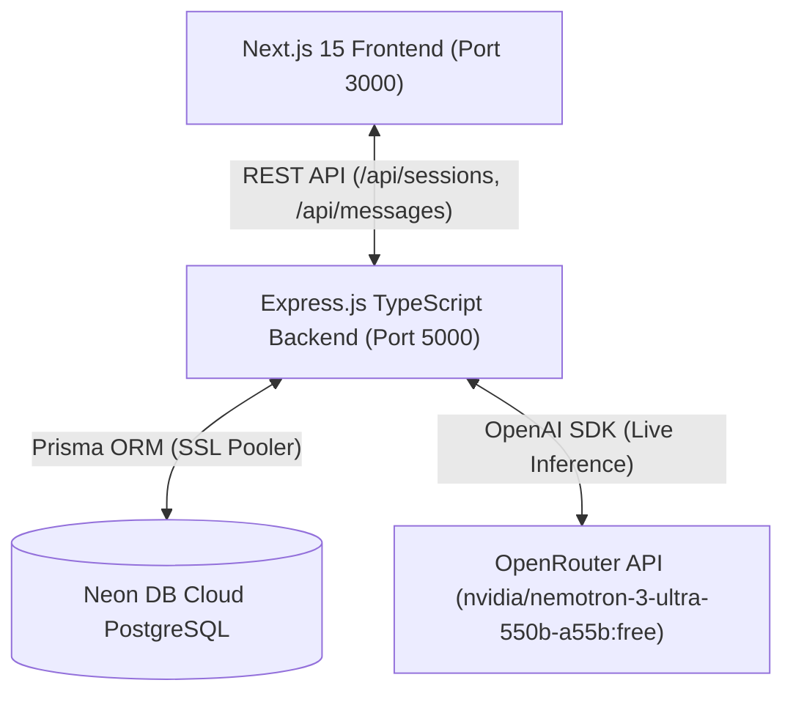

# Walkthrough - PromptCraft Studio (OpenRouter Live Edition)

PromptCraft Studio is a full-stack, educational AI Text Assistant engineered to solidify **LLM Fundamentals**, **LLM Behavior Controls**, and **Prompt Engineering** programmatically, backed by **Neon DB (Serverless PostgreSQL)** and powered live by **OpenRouter (NVIDIA Nemotron 550B Free)**.

---

## 1. Live Architecture



---

## 2. Configuration & Live Verification

### Active Configuration (`backend/.env`)
- **Database:** `DATABASE_URL` connected to Neon DB Serverless PostgreSQL (`ep-holy-smoke-bezvibnx-pooler...`).
- **AI Provider:** `OPENROUTER_API_KEY` configured.
- **Model:** `OPENROUTER_MODEL="nvidia/nemotron-3-ultra-550b-a55b:free"`.
- **Mock Mode:** `USE_MOCK_LLM=false` (**Mock is permanently stopped; live inference active**).

### Live Verification Test Results
1. **Health Check (`GET /api/health`):**
   ```json
   {
     "status": "healthy",
     "database": {
       "provider": "Neon DB (Serverless PostgreSQL)",
       "connected": true,
       "message": "Successfully connected to Neon DB Serverless PostgreSQL."
     },
     "llm": {
       "provider": "OpenRouter (nvidia/nemotron-3-ultra-550b-a55b:free)",
       "model": "nvidia/nemotron-3-ultra-550b-a55b:free",
       "mode": "live"
     }
   }
   ```
2. **Live LLM Inference & Neon DB Persistence:**
   - **User Prompt:** *"What are the primary differences between fine-tuning and prompting? Keep it to 2 concise bullets."*
   - **Assistant Reply Generated by NVIDIA Nemotron 550B:**
     > *"Mechanism: Fine-tuning updates model weights via gradient descent on a labeled dataset; prompting freezes weights and steers behavior via input context..."*
   - **Telemetry:**
     - `isMock: false`
     - `latencyMs: 2362ms`
     - `promptTokens: 42`
     - `completionTokens: 114`
     - `totalTokens: 156`
   - Both user and assistant records were written directly to your live Neon DB `messages` table.

---

## 3. How to Run

### Start Backend (Port 5000)
```bash
cd backend
npm run dev
```

### Start Frontend (Port 3000)
```bash
cd frontend
npm run dev
```

### Access Application
Open your browser to: **[http://localhost:3000](http://localhost:3000)**
